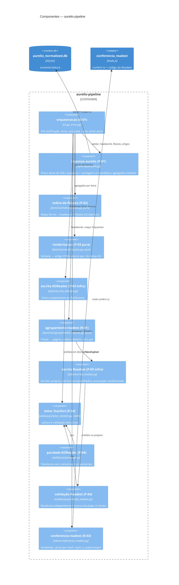

# C4 Nível 3 — Componentes do `aurelio-pipeline`

> Gerado pelo reversa-architect em 2026-07-03 (então planejado); re-extraído em 2026-10-15, agora a partir do código. Todo o nível é 🟢.

## Contratos entre componentes

| Produtor → Consumidor | Estrutura | Origem |
|-----------------------|-----------|--------|
| ingestão → índice | iteradores `(id, head, forma_bruta)` de `flexions` e `conjugations` | `infra/repositorio.py` |
| ingestão → renderização | `(lema, list[Verbete])` na ordem de fusão | idem |
| índice → escritas e validações | `dict[lema, list[forma]]` + `RelatorioCobertura` | `dominio/indice_flexoes.py` |
| renderização → escritas | `str` HTML por lema (em memória quando o Readest está no alvo) | `dominio/renderizacao.py` |
| escrita KOReader → paridade | diretório `dist/aurelio-stardict/` + `ResultadoBuild` | `infra/escrita_stardict.py` |
| agrupamento → escrita Readest | `PlanoPaginas` + `RelatorioAgrupamento` | `dominio/agrupamento_readest.py` |
| escrita Readest → validação e conferência | `ResultadoEscritaReadest` (preparo, artefato, expectativa TSV, impressão digital) | `infra/escrita_readest.py` |
| conferência → orquestração | JSON do roteiro com `veredito` normalizado | `infra/conferencia_readest.py` |
| validações → orquestração | `ParityReport` | `validacao/` |

## Independências deliberadas

- 🟢 A validação do Readest **não** importa o agrupamento nem o escritor: recalcula as páginas por conta própria.
- 🟢 O leitor StarDict não importa o PyGlossary.
- 🟢 A conferência só fala com o Node por subprocesso e por arquivos (artefato e expectativa); o código do Readest nunca entra no processo Python.
