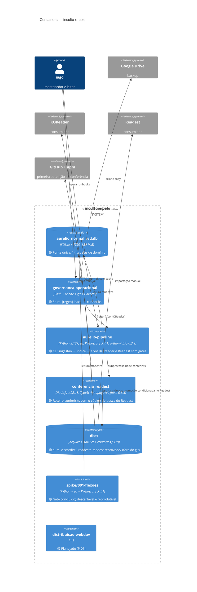

# C4 Nível 2 — Containers

> Gerado pelo reversa-architect em 2026-07-03; re-extraído em 2026-10-15. 🟢 existente, 🟡 planejado.

## Notas

- 🟢 Não há serviço residente: todos os containers são processos sob demanda do mantenedor.
- 🟢 `conferencia_readest` não tem estado próprio além do cache local (`.cache/<tag>/`) e de `node_modules/`, ambos fora do git e regeneráveis.
- 🟢 O spike não é mais exigido pelo fluxo de produção; fica como evidência reprodutível do veredito.
