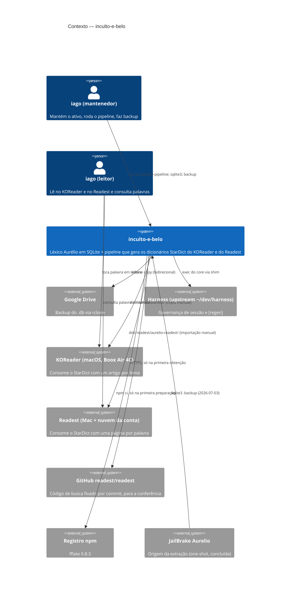

# C4 Nível 1 — Contexto

> Gerado pelo reversa-architect em 2026-07-03; re-extraído em 2026-10-15. 🟢 existente, 🟡 planejado.

## Leitura

- 🟢 O sistema não expõe serviço algum: é local e roda sob demanda. As fronteiras externas são o armazenamento (Drive), a governança (Harness), os dois leitores e, só na primeira conferência, o GitHub e o npm.
- 🟢 A nuvem do Readest guarda o dicionário importado na conta privada do usuário, o que não constitui publicação (ADR-0009).
- 🟡 A distribuição WebDAV (`sdd/distribuicao-webdav.md`) segue planejada e não implementada.
