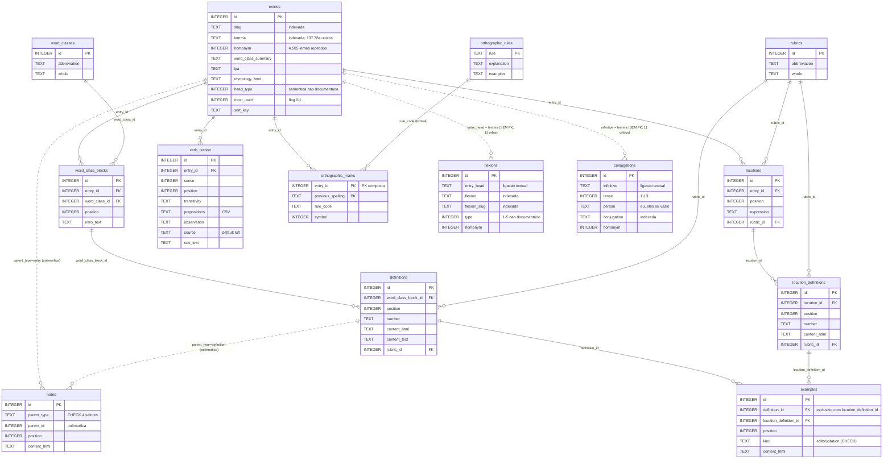
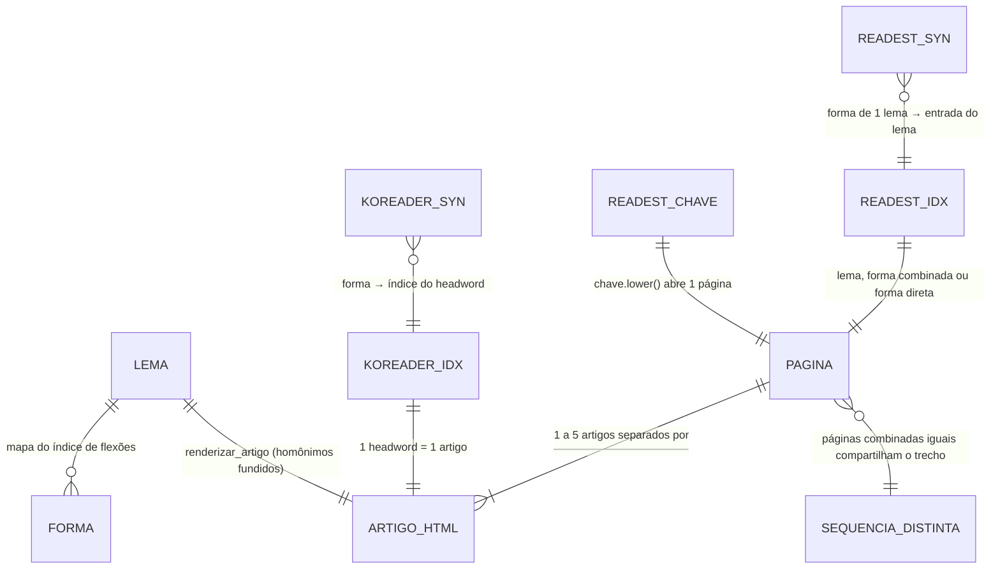

# ERD completo — aurelio_normalized.db

> Gerado pelo reversa-architect em 2026-07-03 a partir do DDL real; conferido na re-extração de 2026-10-15 (banco inalterado, mesmas contagens). 🟢 CONFIRMADO.
> Linhas tracejadas conceituais: ligações **textuais sem FK** (integridade por convenção).

## Cardinalidades e volumes

| Relação                         | Cardinalidade | Volume médio                                 |
| ------------------------------- | ------------- | -------------------------------------------- |
| entries → word_class_blocks     | 1:N           | 1,17 blocos/verbete (168.361/143.376)        |
| word_class_blocks → definitions | 1:N           | 1,54 acepções/bloco (259.337/168.361)        |
| definitions → examples          | 1:N esparso   | 54.726 exemplos p/ 259.337 acepções          |
| entries → locutions             | 1:N esparso   | 22.168 locuções                              |
| entries ⇢ flexions              | 1:N textual   | 175.259 formas                               |
| entries ⇢ conjugations          | 1:N textual   | 869.119 formas (~12.972 verbos × ~67 formas) |

## FTS5 (fora do ERD relacional)

`fts_entries` (lemma/slug/classe) e `fts_definitions` (content_text) são tabelas virtuais **external content** apontando para `entries` e `definitions` via `content_rowid` — dependem do mesmo arquivo e quebram em cópias parciais.

## Modelo lógico dos artefatos derivados (re-extração de 2026-10-15)

🟢 Não são tabelas: é a estrutura dos arquivos StarDict gerados pelo pipeline, descrita como entidades para mostrar as cardinalidades.

| Entidade lógica | Volume no último build |
|-----------------|------------------------|
| LEMA / ARTIGO_HTML | 137.784 |
| FORMA (pares gravados) | 774.003 |
| KOREADER_IDX / KOREADER_SYN | 137.784 / 774.003 |
| READEST_CHAVE / PAGINA | 887.546 |
| READEST_IDX / READEST_SYN | 160.302 / 727.244 |
| SEQUENCIA_DISTINTA (páginas combinadas) | 16.910 para 22.913 páginas |
