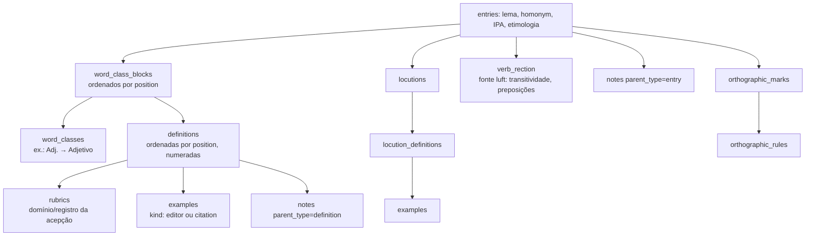
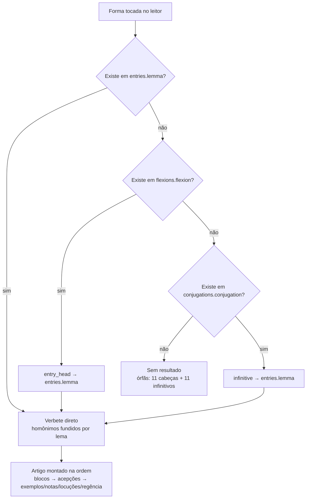
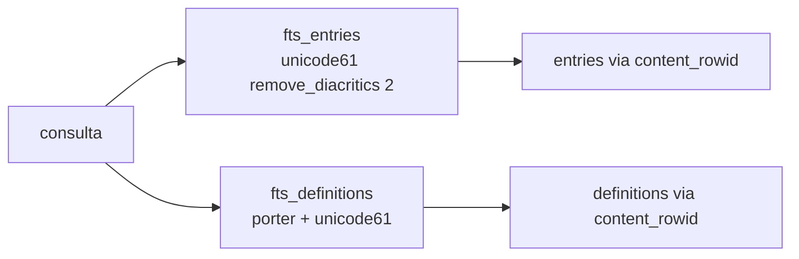

# Flowchart — módulo `banco-lexical`

> Gerado pelo reversa-archaeologist em 2026-07-03; revisto em 2026-10-15. O módulo é dado puro; os fluxos abaixo descrevem (1) a composição de um verbete e (2) o lookup de leitura, hoje materializado em StarDict pelo pipeline (ver `pipeline-nucleo.md`, `pipeline-koreader.md` e `pipeline-readest.md`).

## 1. Composição de um verbete completo

## 2. Lookup de uma forma tocada (implementado pelo pipeline desde as features 002 e 003)

⚠️ As ligações `flexions.entry_head ↔ entries.lemma` e `conjugations.infinitive ↔ entries.lemma` são **textuais, sem FK** — a resolução de órfãs é responsabilidade de quem consome.

## 3. Busca textual (FTS5)

