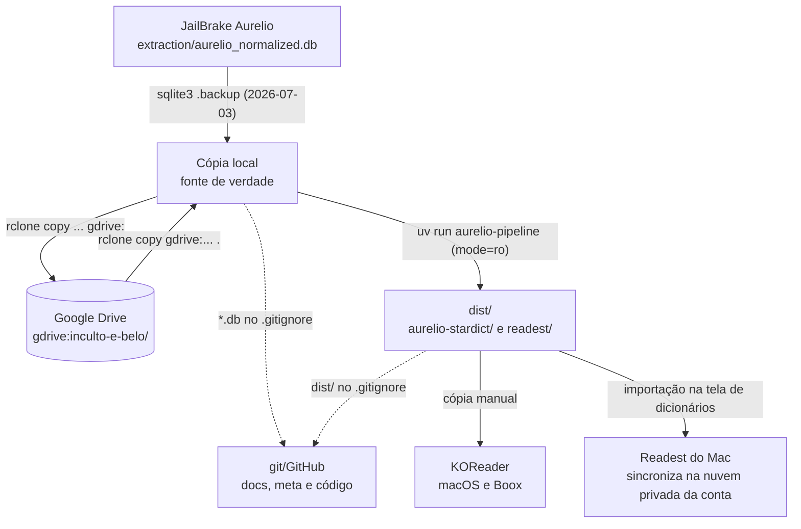
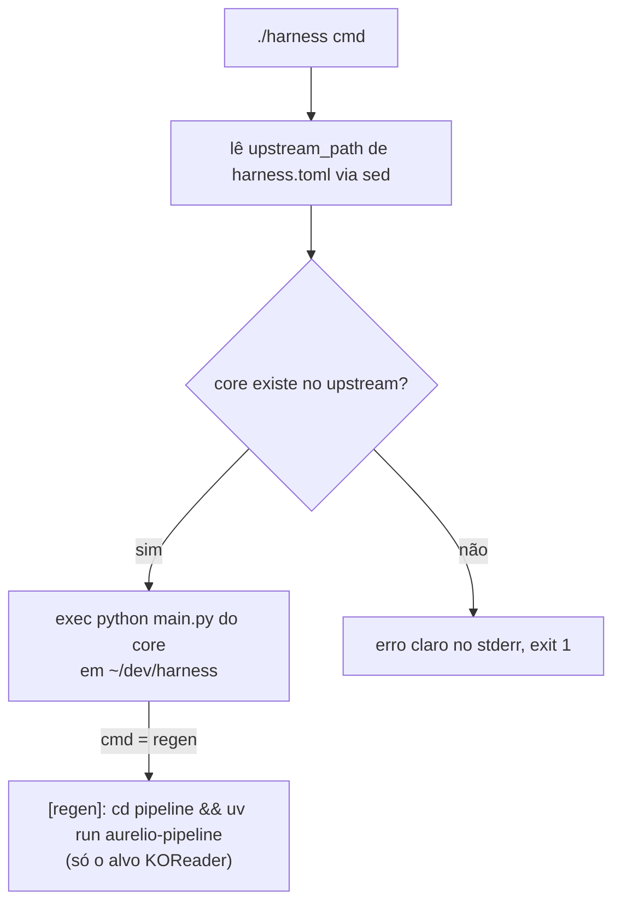
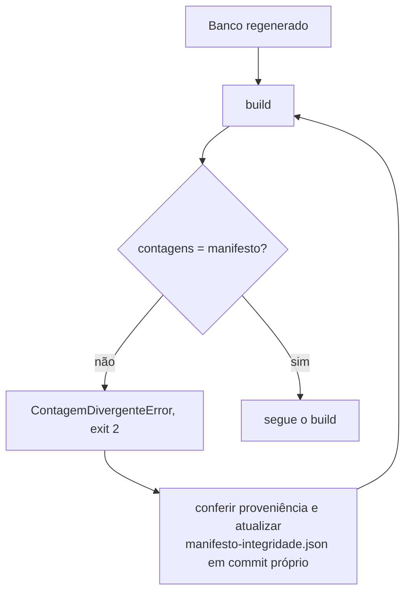

# Flowchart — módulo `governanca-operacional`

> Gerado pelo reversa-archaeologist em 2026-07-03; revisto em 2026-10-15 (seção `[regen]` ativa e artefatos derivados fora do git).

## 1. Ciclo de vida do ativo de dados e dos artefatos derivados

## 2. Shim do Harness e regeneração

## 3. Banco mudado (atualização deliberada)

Riscos mapeados: backup único no Drive; sem verificação automática de integridade logo após a restauração, embora o primeiro build confira esquema e contagens.
