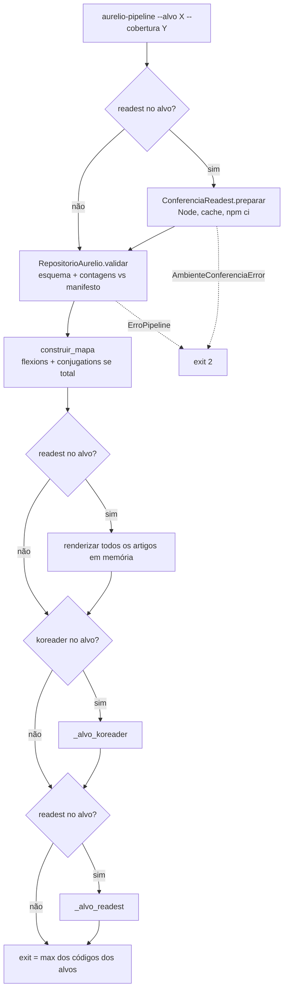
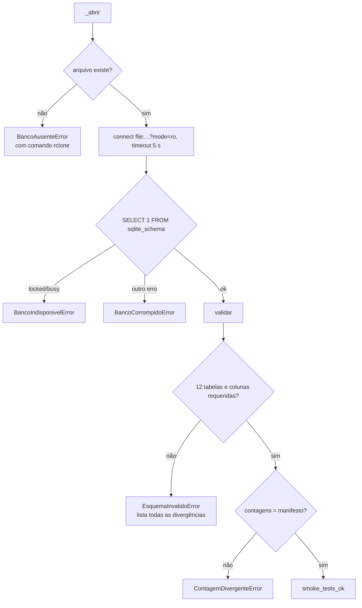
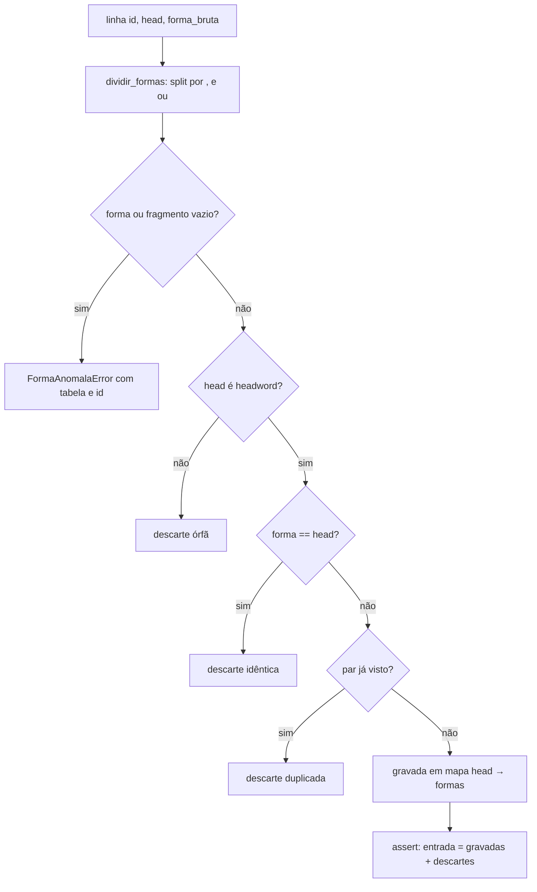
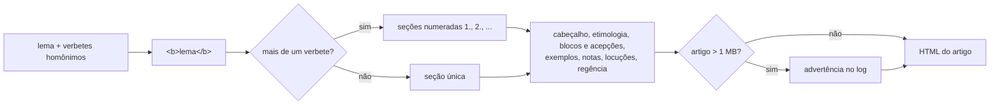

# Flowchart — módulo `pipeline-nucleo`

> Gerado pelo reversa-archaeologist em 2026-10-15.

## 1. Orquestração da CLI (`executar`)

## 2. Ingestão e validação do banco

## 3. Classificação de cada forma (`construir_mapa`)

## 4. Renderização de um artigo

