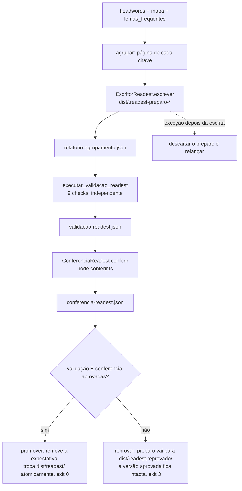
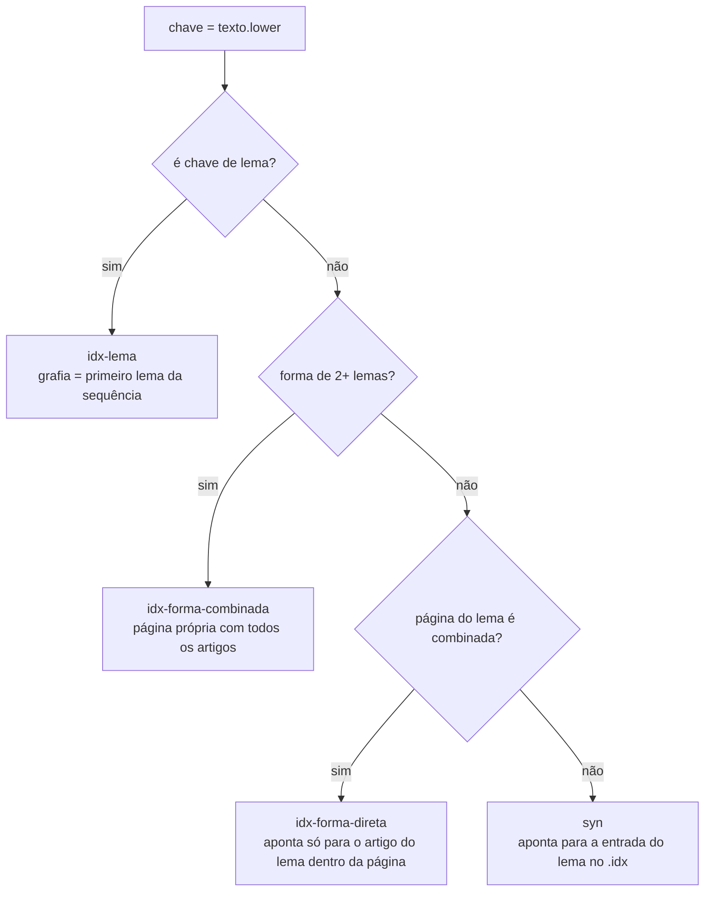
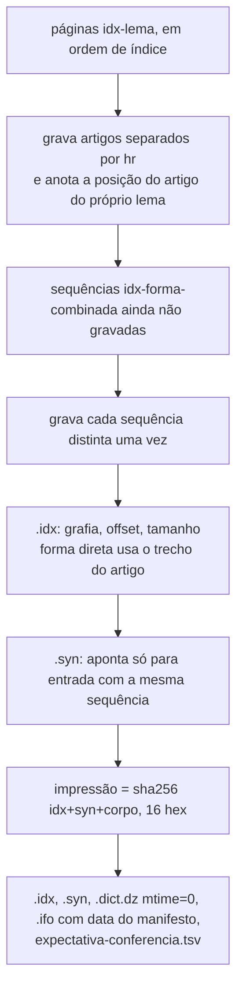
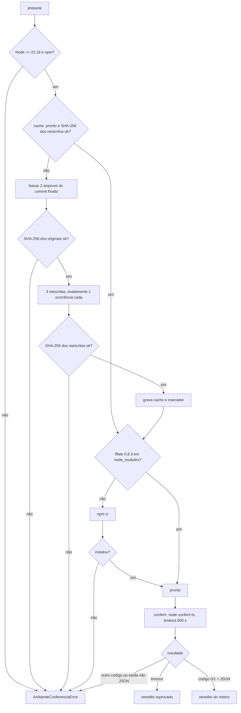
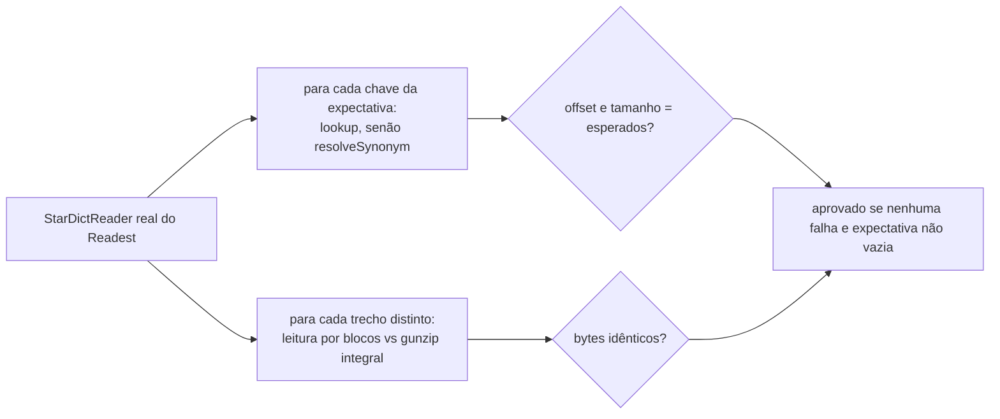

# Flowchart — módulo `pipeline-readest`

> Gerado pelo reversa-archaeologist em 2026-10-15.

## 1. Alvo Readest com gate de duas etapas (`_alvo_readest`)

## 2. Destino de cada chave no índice (`agrupar`)

Ordem dos artigos numa página: lemas coincidentes com a chave (grafia exata primeiro), depois vocabulário frequente, desempate alfabético sem diacríticos e pela grafia. Formas sem letra são descartadas antes.

## 3. Montagem do corpo (`_gravar`)

## 4. Preparação e execução da conferência

## 5. Roteiro `conferir.ts`

