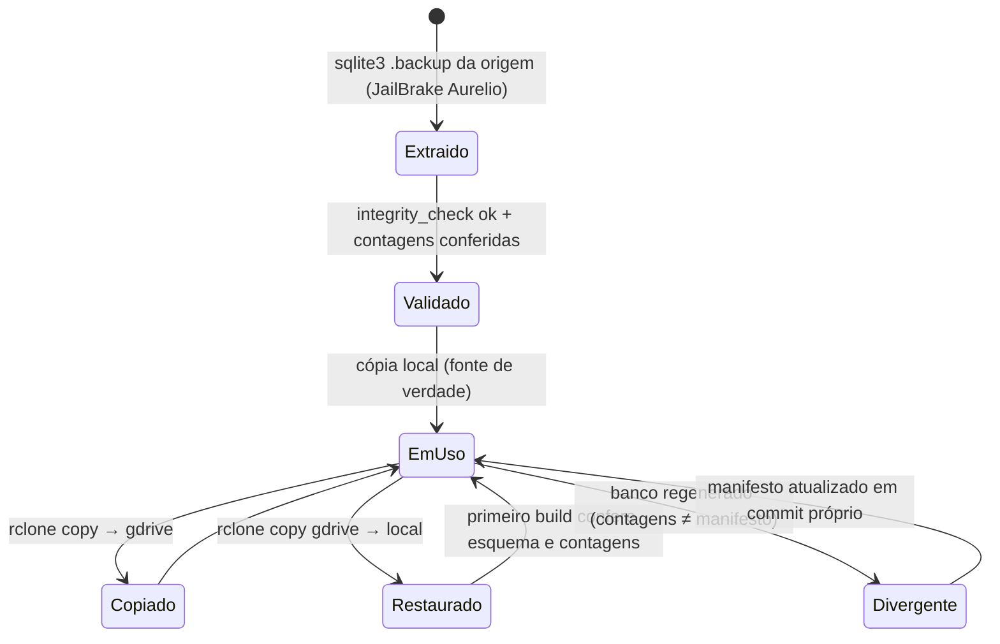
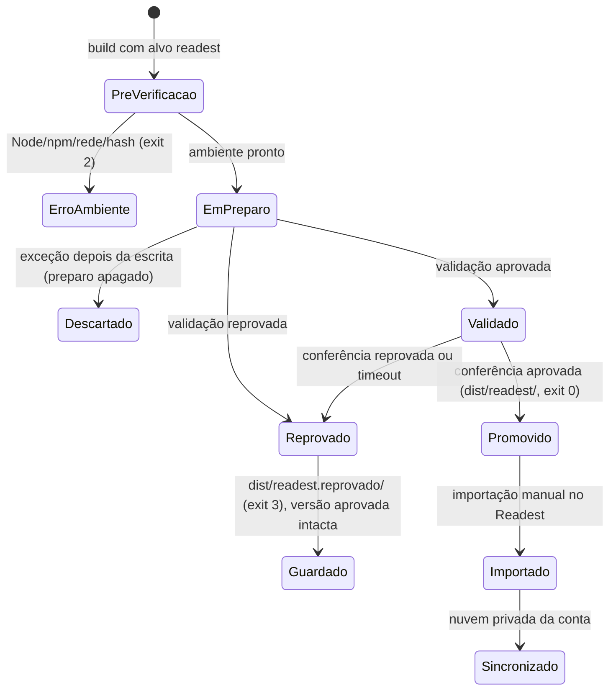
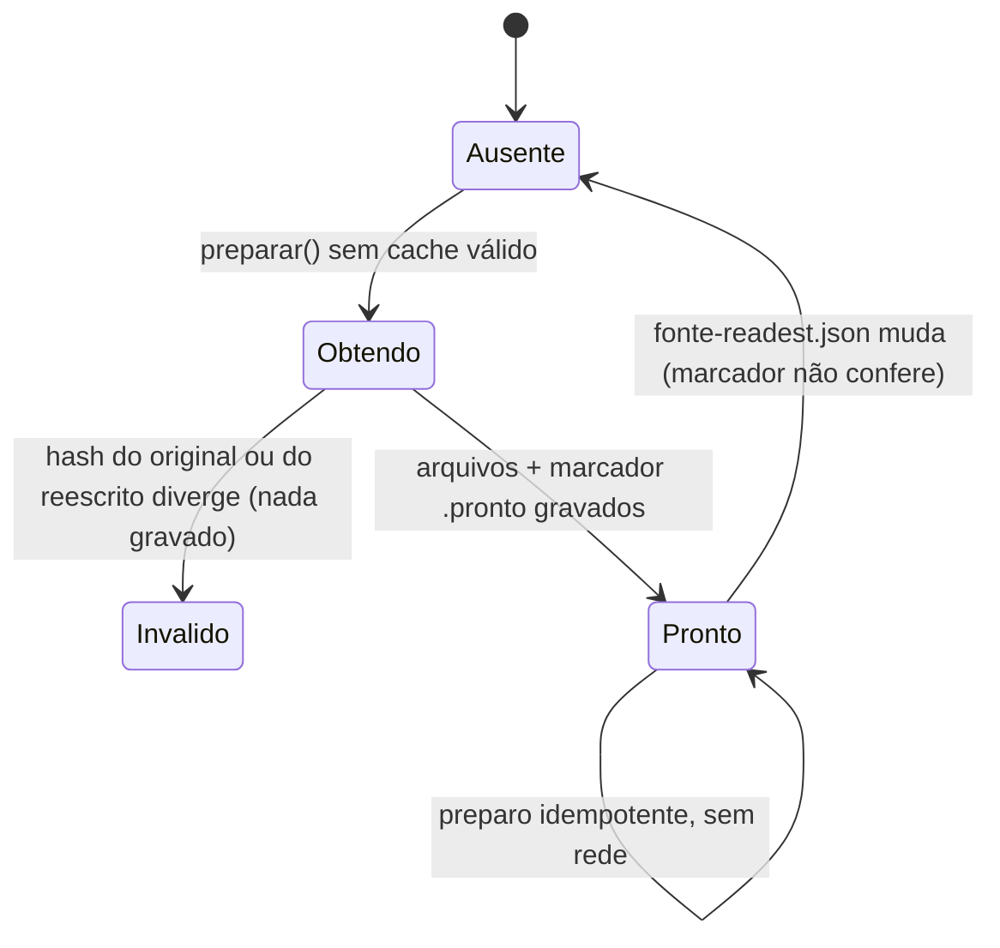
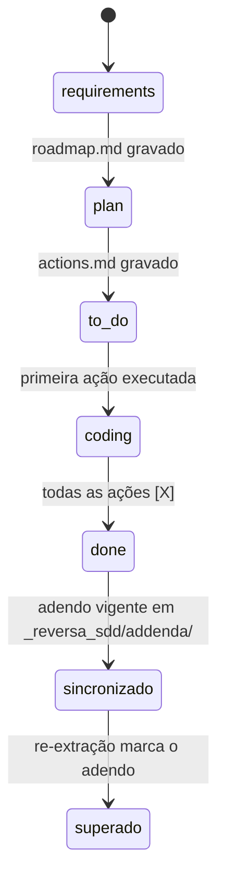

# Máquinas de estado — inculto-e-belo

> Gerado pelo reversa-detective em 2026-07-03; re-extraído em 2026-10-15

## Veredito

🟢 **Nenhuma entidade do banco tem campo de status ou transições de estado.** O dado é um snapshot editorial estático, que muda só de versão quando o banco inteiro é regenerado a partir da origem.

As dinâmicas de estado do projeto são **operacionais**: o ciclo de vida do ativo, dos dois artefatos derivados, do cache da conferência e das features do ciclo forward.

## 1. Ciclo de vida do ativo `aurelio_normalized.db`

🟡 Não há verificação automática logo após a restauração, mas o primeiro build depois dela confere esquema e contagens contra o manifesto.

## 2. Artefato do KOReader (`dist/aurelio-stardict/`)

```mermaid
stateDiagram-v2
    [*] --> EmEscrita: build com alvo koreader
    EmEscrita --> Falhou: FalhaGeracaoError (exit 2), dist/ intocado
    EmEscrita --> Trocado: rename atômico, versão anterior apagada
    Trocado --> Aprovado: paridade aprovada (exit 0)
    Trocado --> Reprovado: paridade reprovada (exit 3)
    Aprovado --> Instalado: cópia manual para o KOReader
    Reprovado --> [*]: não instalar; corrigir e regenerar
```

🟢 A troca acontece antes do veredito: um artefato reprovado ocupa `dist/aurelio-stardict/` até o próximo build.

## 3. Artefato do Readest (gate de duas etapas)

🟢 Os estados `Validado` e `Reprovado` refletem a ordem real do código: a conferência roda mesmo quando a validação reprova, e o veredito final exige as duas aprovadas.

## 4. Cache da conferência (`pipeline/conferencia_readest/.cache/<tag>/`)

## 5. Ciclo forward das features (governança Reversa, não dado)

🟢 Situação em 2026-10-15:
- **001-spike-de-flexoes:** `done`, com veredito GO presumido.
- **002-build-completo-de-producao:** `done`, sem adendo de sync.
- **003-dicionario-readest:** `done`, com adendo vigente até esta re-extração.
